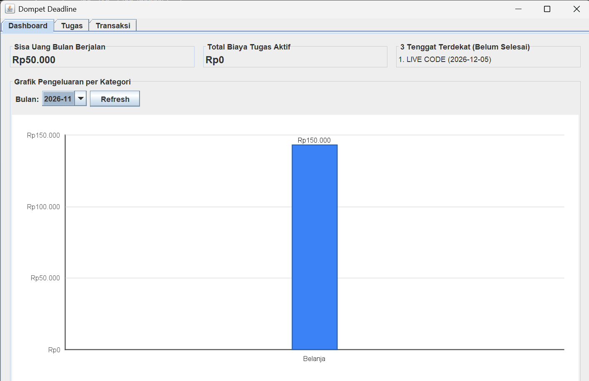
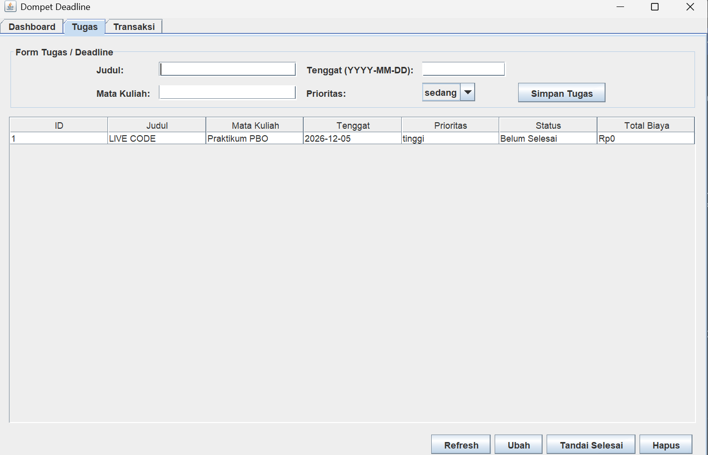
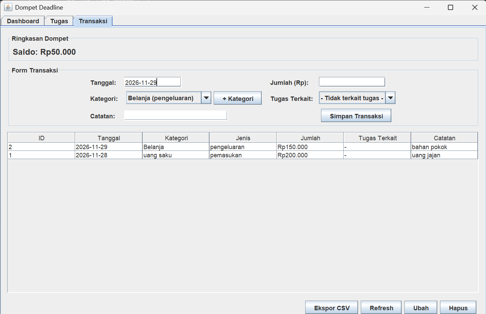

# Dompet Deadline

Aplikasi desktop Java Swing untuk mengelola tenggat tugas kuliah sekaligus mencatat pemasukan dan pengeluaran harian (termasuk biaya yang terkait dengan tugas tertentu) menggunakan database lokal SQLite.

## Masalah yang Diselesaikan
Pengelolaan jadwal tenggat tugas dan catatan keuangan harian sering dilakukan di tempat terpisah, sehingga menyulitkan pemantauan sisa uang bulanan, total biaya per tugas, serta pengingat tenggat yang mendekat dalam satu aplikasi.

## Demo / Tangkapan Layar
### Dashboard

### Manajemen Tugas

### Manajemen Transaksi

## Fitur Utama
- **Dashboard:** Menampilkan sisa uang bulan berjalan, total biaya tugas aktif, 3 tenggat terdekat yang belum selesai, serta grafik pengeluaran per kategori pada bulan yang dipilih.
- **Manajemen Tugas:** Tambah, ubah, tandai selesai, hapus (dengan konfirmasi), dan lihat total biaya per tugas.
- **Manajemen Transaksi:** Tambah kategori baru (+ Kategori), catat pemasukan dan pengeluaran (opsional ditautkan ke tugas tertentu), ubah, hapus (dengan konfirmasi), urutkan kolom tabel, dan ekspor data ke CSV.
- **Pengingat Tenggat:** Memeriksa tenggat tugas aktif yang mendekati batas 24 jam secara berkala tanpa mengulang notifikasi untuk tugas yang sama.

## Struktur Proyek
- src/model/ - Kelas entitas (Tugas, Transaksi, Kategori).
- src/repository/ - Koneksi SQLite (user.home/dompet_deadline.db) dan akses data dengan PreparedStatement.
- src/service/ - Logika bisnis, perhitungan keuangan/biaya tugas, pengingat tenggat, dan ekspor CSV.
- src/view/ - Antarmuka Swing (DashboardPanel, TugasPanel, TransaksiPanel, GrafikPengeluaranPanel, KategoriDialog).
- src/Main.java - Titik masuk aplikasi dan perakitan komponen MVC.
- test/service/ - Unit test JUnit untuk kelas logika.

## Cara Kompilasi dan Menjalankan
Pastikan JDK dan driver JDBC SQLite (lib\sqlite-jdbc-3.54.1.0.jar) tersedia:

javac -encoding UTF-8 -cp "lib\sqlite-jdbc-3.54.1.0.jar" -d out (Get-ChildItem -Path "src" -Filter "*.java" -Recurse | ForEach-Object { .FullName })
java --enable-native-access=ALL-UNNAMED -cp "out;lib\sqlite-jdbc-3.54.1.0.jar" Main

### Menjalankan Berkas .jar dari GitHub Releases
Setelah mengunduh DompetDeadline.jar dari tab Releases di repositori GitHub:

java --enable-native-access=ALL-UNNAMED -cp "DompetDeadline.jar;lib\sqlite-jdbc-3.54.1.0.jar" Main

### Menjalankan Unit Test JUnit
Pastikan junit-platform-console-standalone-1.11.4.jar berada di folder lib\:

$junitJar = Get-ChildItem -Path "lib" -Filter "junit-platform-console-standalone*.jar" | Select-Object -First 1 -ExpandProperty FullName
javac -encoding UTF-8 -cp "lib\sqlite-jdbc-3.54.1.0.jar;;out" -d out-test (Get-ChildItem -Path "test" -Filter "*.java" -Recurse | ForEach-Object { .FullName })
java -jar  execute --class-path "out;out-test;lib\sqlite-jdbc-3.54.1.0.jar" --scan-class-path

## Lisensi
Proyek ini menggunakan lisensi MIT. Lihat berkas LICENSE.